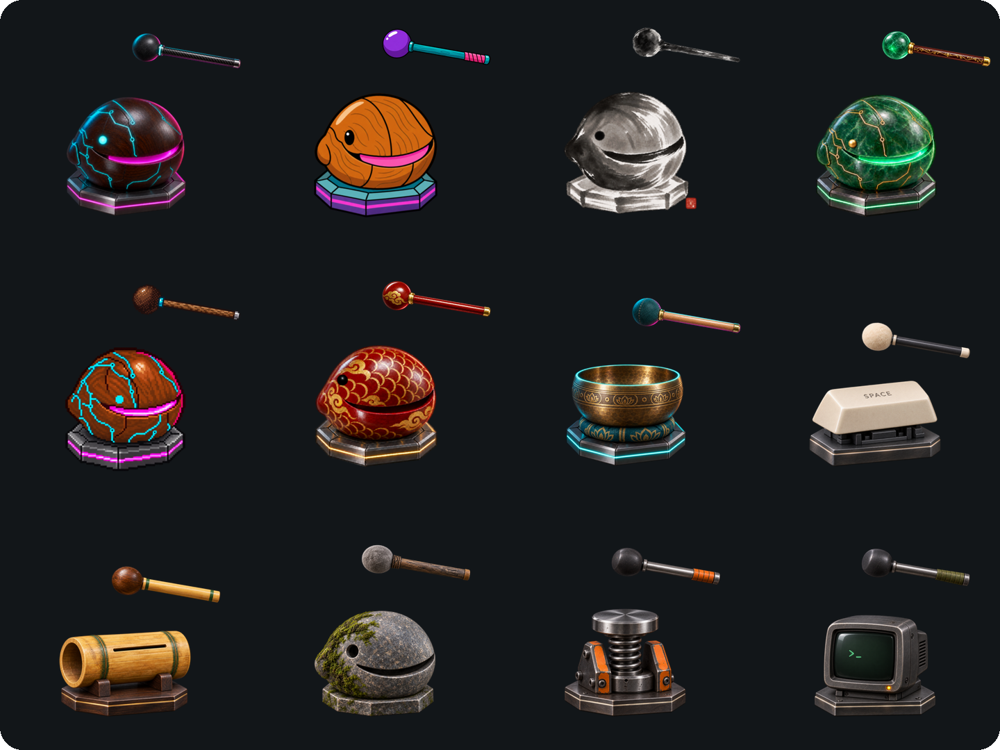

# Plinth

[English](README.md) · 简体中文 · [plinth.fish](https://plinth.fish/zh/)

一条住在 Mac 桌面上的小木鱼。点它一下，笃的一声，仅此而已，敲了也不积功德。



寺院诵经时用木鱼打拍子。至于为什么刻成鱼的样子，《敕修百丈清规》里有一句：「鱼昼夜常醒，刻木象形击之，所以警昏惰也。」Plinth 用水墨画一条这样的木鱼，放在小小的底座上，摆在你的窗口旁边。

很多电子木鱼每敲一下就飘出一个「功德 +1」，还一直替你记着总数，Plinth 不记。梁武帝问达摩：「造寺写经度僧，有何功德？」达摩说：「并无功德。」你敲下第一声，得到的也是这个回答。番茄钟把流逝的每一秒贴在眼前，习惯工具用连胜和排行榜催你打卡，连放松和专注都成了另一本账；Plinth 不记数，也不读秒。十四句禅宗原典每天说一句，最后落入维摩诘的一默，往后就只是敲。

过去用电脑，人眼总是锁在当前窗口上；如今测试与构建在后台跑着，几个编程助手各自干活，人常在别处读书、思考或歇息。视线早已满了，弹窗和红点只添烦乱。几百年前，禅堂里几十人各自参究，不靠传话也不看表，只凭「犍槌」（木鱼、铜磬、云板）几声轻重缓急的敲击——点香敲一下止静，燃尽敲三下开静——便能让一堂人同止同起。Plinth 做的也是这件事：安装包里没有一段录音，每一声都在木槌落下的瞬间实时合成；不申请输入监控，也不碰麦克风。它只是安静地立在桌角，替你守着呼吸的节拍，或在你离开的当口，敲响三声唤你回来。

## 安装

Plinth 需要 macOS 14 Sonoma 或更新版本，支持 Apple 芯片和 Intel。

1. 从 [plinth.fish](https://plinth.fish/zh/) 下载 Plinth，或者从 [Releases](https://github.com/rubycatco/plinth/releases) 下载 `Plinth-x.y.z.dmg`。
2. 打开它，把 Plinth 拖进「应用程序」文件夹。
3. 如果旧版正开着，先右键木鱼，选 **退出 Plinth**。

发布版用 Developer ID 签名，并经过 Apple 公证，打开时不会有 Gatekeeper 警告。Plinth 每天问一次 GitHub 有没有新版本，装之前先问你，也可以在设置里关掉。想自己构建，见[从源码构建](#从源码构建)。

## 卸载

「雁无遗踪之意，水无留影之心。」Plinth 在偏好设置里记着你的设置、说到哪一句、木鱼摆在哪儿；你的皮肤放在 `~/Library/Application Support/Plinth`；另有 macOS 替它检查更新时留的缓存。Mac App Store 版把这些都放在自己的容器里。除此之外什么也不留。如果开着**登录时打开**，先在设置里关掉，再在终端里运行下面这段，App 和它留下的东西就都删干净了：

```sh
osascript -e 'quit app "Plinth"'
defaults delete dev.rubycat.plinth
rm -rf /Applications/Plinth.app \
  ~/Library/Preferences/dev.rubycat.plinth.plist \
  ~/Library/"Application Support"/Plinth \
  ~/Library/Caches/dev.rubycat.plinth \
  ~/Library/HTTPStorages/dev.rubycat.plinth \
  ~/Library/HTTPStorages/dev.rubycat.plinth.binarycookies \
  ~/Library/Containers/dev.rubycat.plinth \
  ~/Library/"Application Scripts"/dev.rubycat.plinth \
  "$(getconf DARWIN_USER_CACHE_DIR)dev.rubycat.plinth"
```

你自己的皮肤也会一并删掉，想留着就先拷出来。

## 木鱼

点木鱼就是敲，拖动可以换位置。右键点木鱼，或者点菜单栏上的图标，会打开菜单与**设置…**。菜单栏图标和桌面上的木鱼用的是同一款皮肤。

- **每一声都不一样。** 敲击声在木槌落下的瞬间实时合成：按得重就敲得重、声音更亮，敲偏了听到更多外壳的声音；木头与殿堂的声响还会随晨昏与四时变化。凌晨四点早板，触壳短促清越；深夜晚板，壳面高频与起音锐度收敛，腹腔低鸣稍增，温润内敛。敲前静得越久，余音越长；久静后亲手一敲，木槌在鱼上略作停驻，再徐徐抬起（压槌），任余音自行消歇。声音从木鱼所在的屏幕方位传来，回荡的**空间**由你选，从禅房到大殿；戴耳机能听出它在哪儿。连着敲，余音会叠在一起。用压感触控板时，指尖能感到木槌落下。
- **自动敲击。** 每 0.4 到 8 秒一下——菜单里可以直接选**随息 · 每 6 秒**、**慢 · 每 2 秒**、**中 · 每 1 秒**或**快 · 每 0.5 秒**——敲法可选**匀速**、**起板**或**随性**（像人手打拍子，间隔稍长或稍短）。**起板**十五槌一轮：起首三慢槌沉稳，入催板渐快而渐轻，密而不噪；第十五槌前微顿半拍，重落定拍、压槌稍驻，再入下一轮休止。可以选敲满 108 下就停，正好念珠一圈：最后三下渐慢收板（煞板），第 108 下压槌稍驻、缓缓归位，余音放尽，归于止静。屏幕睡下一小时后，自动敲击也会歇下，好让 Mac 睡。
- **点一炷香。** 可选**半炷香 · 25 分钟**、**一炷香 · 45 分钟**或**长香 · 60 分钟**。这是约略的香期，不是精确计时：每炷点燃时定下一次约 ±2% 的自然浮动。香立在木鱼旁的香碗里：点香时满余音敲一下，压槌止静；打字伴敲先静三息，约 15 秒。坐香及香尽开静三声期间，自动敲击止息，保留开关和轮次，待开静结束、残香撤去再续。不显示时间，也不计数。选**熄香**可提前结束，不另敲一声；原先开启的自动敲击随即恢复。
- **打字时跟着敲。** 可选。在任何 App 里每按一个键敲一下；急键连绵时，力度和高频渐次收敛，手下越急，声音越温润安静，停顿后再舒展开来，余音也更长。Plinth 只向 macOS 询问上一次按键是多久以前（和系统判断闲置时间用的是同一个计数），始终不知道按的是哪个键，所以不需要辅助功能或输入监控权限。
- **打字久了，敲一下。** 可选，在设置里开启。连着打字半小时、中间没歇过三分钟，木鱼先静三秒，独敲一记警策，压槌按驻、徐徐抬起，余音放尽；打字敲击和自动敲击再静三息，约 15 秒。不计数，也不记录。
- **木槌键。** 可选，在设置里录制。把单键小键盘、脚踏开关或 Stream Deck 按键直接化作木槌：在任何 App 里按下它，就如亲手敲一下，不用移鼠标，也不需要任何权限。F 键可以单独当木槌；其他键要配两个修饰键，其中一个是 ⌘ 或 ⌃，这样 ⌘C、⌃C 这类常用快捷键照常可用。
- **开会时不出声。** 别的 App 在用麦克风时，打字敲、自动敲、点香，以及脚本和快捷指令的敲击，木槌照样落下，但没有声音；只有亲手敲才会响。Plinth 只是问 macOS 哪些 App 在读麦克风，自己从不打开麦克风，所以不需要麦克风权限。默认开启（需 macOS 14.2 或更新版本）。
- **几句话。** 每天（按寺院早板，从凌晨四点算起）亲手敲下的第一声，木鱼有一句话要说，从达摩的「并无功德」到维摩诘的一默，每句只说一次，都用原文。第七句是僧璨《信心铭》：「至道无难，唯嫌拣择。但莫憎爱，洞然明白。」第十四句先浮现「文殊师利问：何等是菩萨入不二法门？」，片刻后问句与出处隐去，空的气泡再停一停，随即消散，不用文字解释沉默。往后就只是敲。设置的**为何是鱼**一页把《百丈清规》那句话写成一幅水墨挂轴，点一下画里的水墨鱼也会响。
- **位置。** 不占程序坞。木鱼有小、中、大三档（150、210、300 pt），可以**浮在窗口上方**，可以**放在桌面上**，也可以选**只闻其声**：不现身，干声的单点感减弱，更多融入周匝余响，所选的**空间**不变。菜单栏图标仍在，那几句话也留到现身时再说。

洞山良价悟无情说法，述偈云：「也大奇！也大奇！无情说法不思议，若将耳听终难会，眼处闻声方得知。」选「只闻其声」，木鱼就只剩耳朵听得见的那一声。

## 唤你回来

脚本和别的 App 也能敲。`open -g plinth://knock` 敲一下（`-g` 让你正在用的 App 留在前台）。`open -g plinth://call` 唤你回来，这样长时间的构建或测试跑完时，木鱼会告诉你：

```sh
make test; open -g plinth://call
```

唤你，是敲三下，和一炷香燃尽时一样：初槌轻叩，破静而不惊定；二槌中平，摄心回神；三槌沉实，压槌稍驻，再徐徐抬起。二、三声之间比一、二声多展半拍。这时自动敲击和打字敲击都静下来，静一会儿再敲这三下，所以不管木鱼刚才在做什么，你都听得出来。亲手敲一下，唤声就停了；第一声响过之后，随手按个键、点一下鼠标，也算应了「诺」，余下的唤声便不再敲。Plinth 没在运行时，这两个 URL 都会把它打开，木鱼出现后再敲。

《无门关》里，瑞岩彦和尚每日自唤「主人公」，复自应「诺」，乃云：「惺惺着！喏。他时异日，莫受人瞒！喏喏。」木鱼唤的那一声，应不应在你。

编程助手离了你走不下去时，也可以唤你。在 Claude Code 里，把下面这个 hook 加进 `~/.claude/settings.json`（已经有 `hooks` 的话，合并进去）。Claude 停下来等你批准时，木鱼唤你。它每回完一句并不唤你，因为那时你多半就在旁边看着：

```json
{
  "hooks": {
    "Notification": [
      {
        "matcher": "permission_prompt",
        "hooks": [{ "type": "command", "command": "open -g plinth://call" }]
      }
    ]
  }
}
```

在 Codex 里，把下面这段加进 `~/.codex/hooks.json`，再在 `/hooks` 里信任它一次。Codex 请你批准时，木鱼唤你：

```json
{
  "hooks": {
    "PermissionRequest": [
      { "hooks": [{ "type": "command", "command": "open -g plinth://call" }] }
    ]
  }
}
```

在「快捷指令」里，Plinth 提供一个「敲一下」动作。只有签名的正式版才能在快捷指令里运行它；自己构建的版本请用上面的 URL。和自动敲击一样，这些敲击不会得到回应。

## 皮肤

自带二十一款皮肤，各有自己的木槌和合成音色。默认是水墨鱼，和图标上的一样；霓虹木鱼和其余皮肤在菜单的**皮肤**里。算盘从不计数，印章落下留一个「空」字，马克杯溅起咖啡，杯里的一滴不少。

自己的皮肤可以是单独一张图片，也可以是一个文件夹：里面有 `idle.png`，还可以放眨眼和被敲中的画面、自己的木槌和敲击效果，以及一个 `skin.json`，写上名字、木槌落在哪里、用哪种敲击声：

```
my-skin/
├── idle.png
├── hit.png
└── skin.json   { "name": "我的皮肤", "strike": [0.6, 0.3], "voice": "jade" }
```

皮肤放在 `~/Library/Application Support/Plinth/Skins/`，也可以用 **皮肤 → 添加皮肤…** 添加。分享皮肤时，发一个 `.plinthskin` 文件就行：双击它，或者把它拖到木鱼上，就装好了。别人做的更多皮肤在[社区画廊](https://github.com/rubycatco/plinth-skins)里（**皮肤 → 浏览更多皮肤…**）。App 运行时，这里的改动会自动生效。完整规格见[皮肤格式](docs/SKINS.zh-Hans.md)。

## 从源码构建

需要 macOS 14 或更新版本，以及 Xcode 16.3 或更新版本。

```sh
git clone https://github.com/rubycatco/plinth.git
cd plinth
./scripts/build_app.sh
open build/Plinth.app
```

脚本会构建同时支持 Apple 芯片和 Intel 的通用二进制，组装出 `build/Plinth.app`，并做 ad hoc 签名。自己构建的版本不会自动更新。想一直用的话，把它拖进 `/Applications`。`./scripts/make_dmg.sh` 会把它打包成磁盘映像，签名、公证和发布的做法见 [docs/RELEASING.md](docs/RELEASING.md)（英文）。开发时也可以直接 `swift run`，但离开 App 包，木鱼找不到自己的图片。

菜单和设置跟随系统语言，系统是简体中文时显示中文，其他情况显示英文。界面文字在 [`App/Resources/zh-Hans.lproj`](App/Resources/zh-Hans.lproj)（`Localizable.strings` 是菜单和设置，`Skins.strings` 是内置皮肤名）；想加一种语言，复制成 `<语言代码>.lproj`，翻译里面的值，再把语言代码加进 [`App/Info.plist`](App/Info.plist) 的 `CFBundleLocalizations`。

```
Sources/Plinth/     SwiftUI + AppKit 源码，KnockSynth.swift 负责合成敲击声
App/                Info.plist、App 图标、磁盘映像背景和打包进 App 的资源（皮肤、木槌、敲击效果、界面文字）
scripts/            构建、打包磁盘映像和生成更新源的脚本
docs/               皮肤格式、发布流程（英文），以及 README 用的图
.github/workflows/  发布流程
tools/              绘制 App 图标、皮肤敲击效果、磁盘映像背景、皮肤总览图和宣传视频的脚本（Python：NumPy、SciPy、Pillow）
```

## 许可

代码采用 [MIT](LICENSE) 许可，美术采用 CC0。敲击声由程序合成，详见 [CREDITS.md](CREDITS.md)（英文）。
